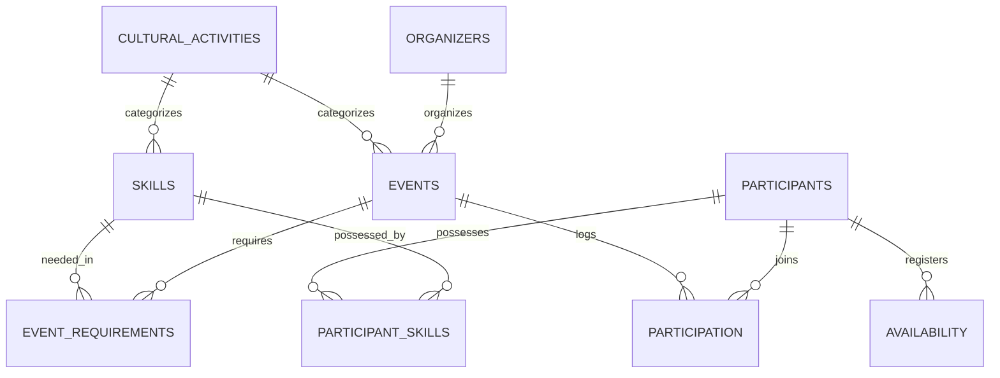

# KalaConnect — Cultural Talent, Availability & Event Coordination System

A College DBMS Mini-Project that centralizes cultural artist discovery, availability scheduling, event requirements matching, and participation tracking across collegiate cultural fests and clubs.

---

## 1. Project Overview

College cultural fest organizers face fragmented talent records, scheduling conflicts, skill mismatches, and no central coordination. KalaConnect solves this with a 3NF-normalized relational database connecting participants, organizers, skills, availability, and events through a full-stack web application.

---

## 2. Tech Stack

| Layer | Technology |
| :--- | :--- |
| Frontend | React 19 + Vite + Tailwind CSS |
| Backend | Node.js + Express.js (REST API) |
| Database | MySQL 8.0+ via mysql2 |
| Tools | MySQL Workbench, Git, GitHub |

---

## 3. Team Division of Responsibilities

| Scope | Member 1 (Talent & Scheduling) | Member 2 (Events & Coordination) |
| :--- | :--- | :--- |
| **Tables** | `participants`, `cultural_activities`, `skills`, `participant_skills`, `availability` | `organizers`, `events`, `event_requirements`, `participation` |
| **SQL Queries** | `queries_member1.sql` — talent catalog, skill lookups, availability conflict detection | `queries_member2.sql` — event deficits, organizer workload, participation tracking |
| **Programmability** | Availability validation trigger (`trigger.sql`) | Talent matching stored procedure (`procedure.sql`) |
| **Shared** | `schema.sql`, `views.sql`, `sample_data.sql`, `inspect_kalaconnect.sql` | Same shared artifacts |

---

## 4. Database Architecture — 9 Core Tables (3NF)



| # | Table | Owner | Purpose |
|---|-------|-------|---------|
| 1 | `participants` | Member 1 | Student profiles — name, email, USN, department, year |
| 2 | `organizers` | Member 2 | Club coordinators and faculty leads |
| 3 | `cultural_activities` | Member 1 | Broad art domains — Dance, Music, Theatre, Visual Arts, Literary Arts |
| 4 | `skills` | Member 1 | Granular talents under each activity (e.g., Bharatanatyam, Tabla) |
| 5 | `participant_skills` | Member 1 | M:N junction — participant ↔ skill with proficiency and experience |
| 6 | `events` | Member 2 | Scheduled competitions and showcases |
| 7 | `event_requirements` | Member 2 | Required skills and headcount per event |
| 8 | `availability` | Member 1 | Participant time slots — Available, Busy, Tentative |
| 9 | `participation` | Member 2 | M:N junction — participant ↔ event with role and status |

---

## 5. Project Structure

```
KalaConnect/
├── .env.example                  # Environment variables template
├── .gitignore
├── package.json
├── README.md
├── backend/
│   ├── server.js                 # Express app entry point
│   ├── config/db.js              # MySQL connection pool
│   ├── controllers/
│   │   ├── participantController.js
│   │   ├── activityController.js
│   │   ├── availabilityController.js
│   │   └── talentController.js
│   └── routes/
│       ├── participants.js
│       ├── activities.js
│       ├── availability.js
│       └── talents.js
├── frontend/
│   ├── src/
│   │   ├── api/index.js          # Axios API client
│   │   ├── components/           # Navbar, Alert, Spinner
│   │   └── pages/                # Dashboard, Participants, Activities, MySkills, Availability, TalentSearch
│   ├── .env                      # VITE_API_URL
│   └── vite.config.js
└── database/
    ├── schema.sql                # 9-table DDL (run first)
    ├── sample_data.sql           # Seed data (run second)
    ├── trigger.sql               # Availability + booking triggers (run third)
    ├── views.sql                 # 4 reusable views (run fourth)
    ├── queries_member1.sql       # 8 Member 1 analytical queries
    ├── queries_member2.sql       # Member 2 queries
    ├── procedure.sql             # Member 2 stored procedures
    ├── test_cases.sql            # Trigger test cases
    ├── TESTING.md                # Full testing guide
    ├── inspect_kalaconnect.sql   # Read-only DB inspection
    └── cleanup_and_setup.sql     # Full rebuild script
```

---

## 6. Member 1 API Endpoints

| Method | Endpoint | Description |
|--------|----------|-------------|
| GET | `/api/health` | Health check |
| GET | `/api/dashboard/stats` | Participant count, skill count, availability summary, category stats |
| GET | `/api/participants` | List all participants |
| POST | `/api/participants` | Register new participant |
| GET | `/api/participants/:id` | Get participant by ID |
| PUT | `/api/participants/:id` | Update participant |
| DELETE | `/api/participants/:id` | Delete participant |
| GET | `/api/activities` | List all cultural activities |
| GET | `/api/activities/:id/skills` | List skills under an activity |
| GET | `/api/participants/:id/skills` | Get participant's skills |
| POST | `/api/participants/:id/skills` | Add skill to participant |
| PUT | `/api/participants/:id/skills/:skillId` | Update participant skill |
| DELETE | `/api/participants/:id/skills/:skillId` | Remove participant skill |
| GET | `/api/participants/:id/availability` | Get participant's availability slots |
| POST | `/api/participants/:id/availability` | Add availability slot |
| PUT | `/api/availability/:id` | Update availability slot |
| DELETE | `/api/availability/:id` | Delete availability slot |
| GET | `/api/talents/search` | Search by skill, category, proficiency |
| GET | `/api/talents/available` | Find available participants by date and time |

---

## 7. Database Triggers

**Member 1 — Availability Triggers (`trigger.sql`)**

- `trg_validate_availability_before_insert` — rejects invalid time periods (start >= end) and overlapping slots on the same date for the same participant. Adjacent slots are allowed.
- `trg_validate_availability_before_update` — same rules on UPDATE, excluding the current row.

**Member 2 — Booking Trigger (`trigger.sql`)**

- `trg_validate_participant_availability_before_booking` — prevents registering a participant who is marked Busy or already confirmed in a simultaneous event.

---

## 8. Database Views (`views.sql`)

| View | Purpose |
|------|---------|
| `v_participant_skill_summary` | Per-participant skill count, activity count, experience rollup |
| `v_talent_directory` | Flattened participant + skill + activity listing for search |
| `v_event_fulfillment_status` | Required vs confirmed headcount per event skill (Member 2) |
| `v_upcoming_event_roster` | Confirmed participant roster for scheduled events (Member 2) |

---

## 9. Setup Instructions

### Prerequisites
- Node.js 18+
- MySQL 8.0+
- MySQL Workbench

### Step 1 — Clone and configure environment

```powershell
cd "C:\Users\Shreya\OneDrive\Desktop\KalaConnect"
Copy-Item .env.example .env
```

Edit `.env` and set `DB_PASSWORD` to your MySQL root password.

### Step 2 — Initialize the database (MySQL Workbench)

Run these files in order using **File → Open SQL Script → ⚡ Execute All**. Before running each file, double-click `kalaconnect` in the left Schemas panel to keep it active.

```
1. Create database manually: run  CREATE DATABASE IF NOT EXISTS kalaconnect;
2. database/schema.sql
3. database/sample_data.sql
4. database/trigger.sql
5. database/views.sql
```

### Step 3 — Start the backend

```powershell
cd backend
npm install
npm run dev
# API running at http://localhost:5000
```

### Step 4 — Start the frontend (new terminal)

```powershell
cd frontend
npm install
npm run dev
# App running at http://localhost:5173
```

---

## 10. Normalization Summary (1NF → 3NF)

- **1NF:** No multi-valued columns. Each participant skill is a separate row in `participant_skills`, not a comma-separated string.
- **2NF:** No partial dependencies. In `participant_skills`, `proficiency_level` depends on both `participant_id` and `skill_id` together.
- **3NF:** No transitive dependencies. `skills` stores `activity_id` (FK), not `activity_name` directly, eliminating the transitive chain `skill_id → activity_id → activity_name`.

---

## 11. Member 1 Implementation Status

| Feature | Frontend Page | API | DB |
|---------|--------------|-----|----|
| Register / edit / delete participant | `/participants` | POST/PUT/DELETE `/api/participants` | `participants` |
| Browse activities and skills | `/activities` | GET `/api/activities` | `cultural_activities`, `skills` |
| Add / edit / remove participant skills | `/skills` | POST/PUT/DELETE `/api/participants/:id/skills` | `participant_skills` |
| Add / edit / delete availability slots | `/availability` | POST/PUT/DELETE `/api/availability` | `availability` |
| Overlap prevention | `/availability` | 409 from trigger | `trg_validate_availability_before_insert/update` |
| Search by skill / category / proficiency | `/search` | GET `/api/talents/search` | `participant_skills`, `skills`, `cultural_activities` |
| Search by availability date/time | `/search` | GET `/api/talents/available` | `availability` |
| Dashboard statistics | `/` | GET `/api/dashboard/stats` | All Member 1 tables |
