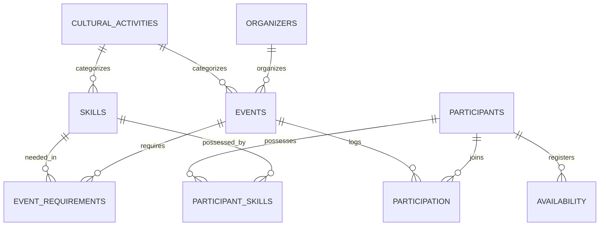

# KalaConnect — Cultural Talent, Availability & Event Coordination System

A centralized College DBMS Mini-Project designed to streamline cultural artist discovery, availability scheduling, event requirements matching, and participation tracking across collegiate cultural fests and clubs.

---

## 1. Project Overview & Motivation

In college campuses, organizing cultural fests (music competitions, dance fests, dramatics, street plays, literary debates, fine arts exhibitions) often suffers from:
- **Fragmented Talent Records:** Student talents are scattered across paper forms, WhatsApp groups, and spreadsheets.
- **Scheduling Conflicts:** Organizers frequently double-book performers who have conflicting class/lab schedules or prior rehearsals.
- **Mismatch in Requirements:** Event managers struggle to identify exact skill proficiencies (e.g., Classical Carnatic Vocal vs. Western Pop Vocal).
- **Lack of Central Coordination:** Tracking whether student participants actually showed up, registered, or won awards is cumbersome.

**KalaConnect** solves this by establishing a robust, 3NF-normalized relational database backplane that connects students (**Participants**), event coordinators (**Organizers**), art forms (**Cultural Activities & Skills**), scheduling (**Availability**), and execution (**Events, Requirements & Participation**).

---

## 2. Tech Stack

- **Database Engine:** MySQL Community Server 8.0+
- **Database Management Tool:** MySQL Workbench
- **Backend API:** Node.js with Express.js (RESTful API architecture)
- **Frontend Client:** React 18+ with Vite
- **Version Control:** Git & GitHub

---

## 3. Team Member Division of Responsibilities

To ensure balanced academic contribution, the system is partitioned into two clear modules sharing a unified database schema:

| Module / Scope | Member 1 (Lead: Talent & Scheduling) | Member 2 (Lead: Events & Coordination) |
| :--- | :--- | :--- |
| **Entities & Tables** | `participants`, `cultural_activities`, `skills`, `participant_skills`, `availability` | `organizers`, `events`, `event_requirements`, `participation` |
| **SQL Queries** | Talent catalog filtering, skill proficiency lookups, availability conflict detection, activity aggregations (`queries_member1.sql`) | Event requirement deficit analysis, organizer workload, participation approval tracking, turnout summaries (`queries_member2.sql`) |
| **Advanced Programmability** | Availability validation & conflict prevention **Trigger** (`trigger.sql`) | Automated event talent matching & registration **Stored Procedure** (`procedure.sql`) |
| **Shared Artifacts** | Unified 9-table schema (`schema.sql`), Database Views (`views.sql`), Sample dataset (`sample_data.sql`), Inspection scripts (`inspect_kalaconnect.sql`) | Same shared schema, views, sample data, and joint schema integrity review |

---

## 4. Database Architecture (The 9 Core Tables)

The system relies on nine strictly coordinated tables adhering to 3rd Normal Form (3NF):



### Table Summary:
1. **`participants`**: Student details (ID, full name, email, phone, college roll/USN, department, year of study).
2. **`organizers`**: Event coordinator details (ID, full name, email, phone, club/department name, designation).
3. **`cultural_activities`**: Broad artistic categories (Performing Arts, Visual Arts, Literary Arts, Musical Arts).
4. **`skills`**: Granular talents (e.g., Bharatanatyam, Beatboxing, Charcoal Sketching) classified under an activity.
5. **`participant_skills`**: **Many-to-Many junction table** connecting participants to their skills with proficiency levels and years of experience.
6. **`events`**: Scheduled cultural competitions, stage showcases, and fests organized by club leads.
7. **`event_requirements`**: Specification of required skills and target participant counts per event.
8. **`availability`**: Time slots and calendar dates when participants are free, preventing double-booking.
9. **`participation`**: **Many-to-Many junction table** recording actual event registrations, performer roles, statuses, and feedback.

---

## 5. Database Normalization (1NF to 3NF) Explained

1. **First Normal Form (1NF) — Atomicity & No Repeating Groups:**
   - No multi-valued attributes: A participant's multiple talents are not stored as comma-separated text (`"Singing, Dancing"`). Instead, each talent is an individual atomic foreign-key record in the junction table `participant_skills`.
   - Every table has a well-defined Primary Key.
2. **Second Normal Form (2NF) — Full Functional Dependency:**
   - Eliminates partial dependencies on composite keys. In `participant_skills(participant_id, skill_id)`, attributes like `proficiency_level` and `years_of_experience` depend on the combination of *both* the participant and the specific skill, not just one of them.
   - Student personal details (like `department`) are kept in `participants`, not repeated in `participant_skills`.
3. **Third Normal Form (3NF) — Elimination of Transitive Dependencies:**
   - Non-key attributes must depend solely on the primary key ($X \rightarrow Y$ where $X$ is a superkey).
   - In `skills`, we do not store `activity_name` directly alongside `skill_name`; rather, we reference `activity_id`. Storing `activity_name` would create a transitive dependency (`skill_id` $\rightarrow$ `activity_id` $\rightarrow$ `activity_name`) causing update and deletion anomalies.

---

## 6. Project Directory Structure

```text
KalaConnect/
├── .env.example              # Environment variables template (copy to .env locally)
├── .gitignore                # Prevents credentials and node_modules from being pushed
├── package.json              # Root project dependencies & metadata
├── README.md                 # Project architecture, guidelines, and team division
└── database/
    ├── schema.sql            # Canonical 9-table schema definition (DDL with 3NF constraints)
    ├── sample_data.sql       # Realistic sample records in dependency order
    ├── queries_member1.sql   # Member 1 queries (Talent catalog, availability, skills)
    ├── queries_member2.sql   # Member 2 queries (Events, requirements, organizer management)
    ├── trigger.sql           # Shared trigger: Conflict detection & availability validation
    ├── procedure.sql         # Shared procedure: Automated talent matching for events
    ├── views.sql             # Reusable business views (Directories, fulfillments)
    └── inspect_kalaconnect.sql# Read-only inspection script for MySQL Workbench
```

---

## 7. Phase 1 Setup Instructions (Safe Database Inspection First)

1. **Do not run `schema.sql` immediately!**
2. Open **MySQL Workbench** and connect to your local MySQL server.
3. Open [`database/inspect_kalaconnect.sql`](file:///c:/Users/Shreya/OneDrive/Desktop/KalaConnect/database/inspect_kalaconnect.sql).
4. Run the read-only queries in Step 1 through Step 6 to inspect existing tables, row counts, and foreign keys.
5. Review the inspection results with your teammate to verify if any existing data in tables like `artistprofiles` or `bookings` needs to be retained.
6. Once approved, the shared canonical schema [`database/schema.sql`](file:///c:/Users/Shreya/OneDrive/Desktop/KalaConnect/database/schema.sql) can be deployed cleanly.
