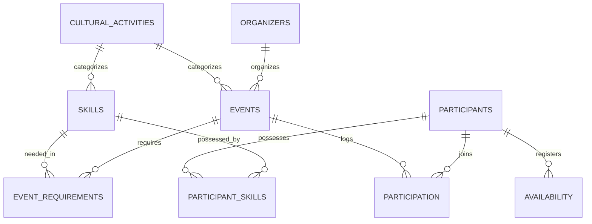

# KalaConnect — Cultural Talent, Availability & Event Coordination System

A centralized College DBMS Mini-Project designed to streamline cultural artist discovery, availability scheduling, event requirements matching, and participation tracking across collegiate cultural fests and clubs.

---

## 1. Project Overview & Motivation

In college campuses, organizing cultural fests (music competitions, dance fests, dramatics, street plays, literary debates, fine arts exhibitions) often suffers from:
- **Fragmented Talent Records:** Student talents are scattered across paper forms, WhatsApp groups, and spreadsheets.
- **Scheduling Conflicts:** Organizers frequently double-book performers who have conflicting class/lab schedules or prior rehearsals.
- **Mismatch in Requirements:** Event managers struggle to identify exact skill proficiencies (e.g., Classical Carnatic Vocal vs. Western Pop Vocal).
- **Lack of Central Coordination:** Tracking whether student participants actually showed up, registered, or won awards is cumbersome.

**KalaConnect** solves this by establishing a robust, 3NF-normalized relational database backplane that connects students (**Participants**), event coordinators (**Organizers**), art forms (**Cultural Activities & Skills**), scheduling (**Availability**), and execution (**Events, Requirements & Participation**).

---

## 2. Tech Stack

- **Database Engine:** MySQL Community Server 8.0+
- **Database Management Tool:** MySQL Workbench
- **Backend API:** Node.js with Express.js (`mysql2/promise` RESTful API architecture)
- **Frontend Client:** React 18+ with Vite & Lucide Icons
- **Version Control:** Git & GitHub

---

## 3. Team Member Division of Responsibilities

To ensure balanced academic contribution, the system is partitioned into two clear modules sharing a unified database schema:

| Module / Scope | Member 1 (Lead: Talent & Scheduling) | Member 2 (Lead: Events & Coordination) |
| :--- | :--- | :--- |
| **Entities & Tables** | `participants`, `cultural_activities`, `skills`, `participant_skills`, `availability` | `organizers`, `events`, `event_requirements`, `participation` |
| **SQL Queries** | Talent catalog filtering, skill proficiency lookups, availability conflict detection, activity aggregations (`queries_member1.sql`) | Upcoming events, participant rosters, requirement deficit analysis, organizer workload, popular event ranking, matching talents (`queries_member2.sql`) |
| **Advanced Programmability** | Availability validation & conflict prevention **Trigger** (`trigger.sql`) | Automated event talent matching & registration **Stored Procedures** (`procedure.sql`) & comprehensive test suite (`test_member2.sql`) |
| **Full Stack Implementation** | Student profile & talent intake module | Organizer dashboard, event manager, skill requirements builder, talent matcher UI & REST APIs |
| **Shared Artifacts** | Unified 9-table schema (`schema.sql`), Database Views (`views.sql`), Sample dataset (`sample_data.sql`), Inspection scripts (`inspect_kalaconnect.sql`) | Same shared schema, views, sample data, and joint schema integrity review |

---

## 4. Database Architecture (The 9 Core Tables)

The system relies on nine strictly coordinated tables adhering to 3rd Normal Form (3NF):



### Table Summary:
1. **`participants`**: Student details (ID, full name, email, phone, college roll/USN, department, year of study).
2. **`organizers`**: Event coordinator details (ID, full name, email, phone, club/department name, designation).
3. **`cultural_activities`**: Broad artistic categories (Performing Arts, Visual Arts, Literary Arts, Musical Arts).
4. **`skills`**: Granular talents (e.g., Bharatanatyam, Beatboxing, Charcoal Sketching) classified under an activity.
5. **`participant_skills`**: **Many-to-Many junction table** connecting participants to their skills with proficiency levels and years of experience.
6. **`events`**: Scheduled cultural competitions, stage showcases, and fests organized by club leads.
7. **`event_requirements`**: Specification of required skills and target participant counts per event.
8. **`availability`**: Time slots and calendar dates when participants are free, preventing double-booking.
9. **`participation`**: **Many-to-Many junction table** recording actual event registrations, performer roles, statuses, and feedback.

---

## 5. Database Normalization (1NF to 3NF) Explained

1. **First Normal Form (1NF) — Atomicity & No Repeating Groups:**
   - No multi-valued attributes: A participant's multiple talents are not stored as comma-separated text (`"Singing, Dancing"`). Instead, each talent is an individual atomic foreign-key record in junction table `participant_skills`.
   - Every table has an atomic, immutable Primary Key.
2. **Second Normal Form (2NF) — Full Functional Dependency:**
   - Eliminates partial dependencies on composite keys. In `participant_skills(participant_id, skill_id)`, attributes like `proficiency_level` and `years_of_experience` depend on the combination of *both* the participant and the specific skill.
   - Student personal details (like `department`) are kept in `participants`, not repeated in `participant_skills`.
3. **Third Normal Form (3NF) — Elimination of Transitive Dependencies:**
   - Non-key attributes depend solely on the primary key ($X \rightarrow Y$ where $X$ is a superkey).
   - In `skills`, we reference `activity_id` rather than storing `activity_name` directly alongside `skill_name`, eliminating transitive dependencies (`skill_id` $\rightarrow$ `activity_id` $\rightarrow$ `activity_name`).

---

## 6. Project Directory Structure

```text
KalaConnect/
├── .env.example              # Environment variables template
├── .env                      # Local system credentials (ignored by git)
├── .gitignore                # Git ignore rules
├── package.json              # Root npm orchestration scripts
├── README.md                 # Complete system documentation
├── database/
│   ├── schema.sql            # Canonical 9-table schema definition (3NF DDL)
│   ├── sample_data.sql       # Realistic sample records in dependency order
│   ├── queries_member1.sql   # Member 1 queries (Talent catalog, availability, skills)
│   ├── queries_member2.sql   # Member 2 queries (Events, requirements, rosters, deficits)
│   ├── trigger.sql           # Trigger: Availability conflict & double-booking prevention
│   ├── procedure.sql         # Stored Procedures: Talent matching & transactional registration
│   ├── test_member2.sql      # Comprehensive test cases for Member 2 scope
│   ├── views.sql             # Reusable virtual tables (Rosters, fulfillments)
│   └── inspect_kalaconnect.sql# Read-only inspection script for MySQL Workbench
├── server/                   # Node.js & Express REST API Backend
│   ├── package.json          # Express, mysql2, cors, dotenv
│   ├── app.js                # Express app setup and middleware
│   ├── index.js              # Server entry point
│   ├── config/
│   │   └── db.js             # mysql2/promise connection pool
│   ├── controllers/
│   │   ├── organizerController.js
│   │   ├── eventController.js
│   │   ├── participationController.js
│   │   ├── reportController.js
│   │   └── lookupController.js
│   └── routes/
│       ├── organizerRoutes.js
│       ├── eventRoutes.js
│       ├── participationRoutes.js
│       ├── reportRoutes.js
│       └── lookupRoutes.js
└── client/                   # React 18 + Vite Desktop Web Client
    ├── package.json          # React, Vite, Lucide icons
    ├── vite.config.js        # Vite config with /api proxy
    ├── index.html            # HTML entry point
    └── src/
        ├── main.jsx          # React DOM entry
        ├── App.jsx           # App shell with responsive tab routing
        ├── index.css         # Modern, desktop-friendly CSS design
        ├── services/
        │   └── api.js        # Reusable fetch client
        └── components/
            ├── Navbar.jsx    # Sticky navigation bar with branding
            ├── Dashboard.jsx # KPI stats, deficit alerts & organizer directory
            ├── EventsManager.jsx # Event creation, editing & filtering
            ├── EventDetail.jsx   # Event requirements builder & progress bars
            ├── TalentMatcher.jsx # Stored procedure execution & quick-register
            ├── ParticipationManager.jsx # Roster & status transition manager
            └── ReportsView.jsx   # Interactive SQL query analytical visualizer
```

---

## 7. Member 2 SQL Queries (`database/queries_member2.sql`)

All queries are documented, tested, and executable on MySQL 8.0+:

1. **Upcoming Events with Organizer Information (Q1):**
   - Retrieves scheduled and ongoing events occurring on or after `CURRENT_DATE`.
   - Joins `events`, `organizers`, and `cultural_activities` to display coordinator contact info, organizing club, and theme.
2. **Participants Registered for a Selected Event (Q2):**
   - Traverses `participation`, `participants`, and `events` for a target event (e.g., `event_id = 201`).
   - Orders rows by status priority using `FIELD(ptn.status, 'Confirmed', 'Shortlisted', 'Registered', 'Attended', 'Cancelled')`.
3. **Unfulfilled Event Requirements / Deficit Analysis (Q3):**
   - Compares the required headcount in `event_requirements` against `COUNT(CASE WHEN ptn.status = 'Confirmed' THEN 1 END)`.
   - Uses `HAVING deficit_headcount > 0` to alert coordinators about staffing shortfalls.
4. **Participant Counts Grouped by Event (Q4):**
   - Uses `LEFT JOIN participation` and conditional aggregation to summarize applicants, confirmed performers, shortlisted students, and pending reviews per event.
5. **Events Belonging to a Particular Organizer (Q5):**
   - Filters events by `organizer_id` to present an individual coordinator's event portfolio.
6. **Popular Events Ranked by Participation (Q6):**
   - Ranks all events by total registrations using the analytical window function `DENSE_RANK() OVER (ORDER BY COUNT(ptn.participation_id) DESC)`.
7. **Participants Who Possess Skills Required by an Event (Q7):**
   - Traverses 5 tables (`events` $\rightarrow$ `event_requirements` $\rightarrow$ `skills` $\rightarrow$ `participant_skills` $\rightarrow$ `participants`) to find all college students who possess any skill required by an event, displaying their proficiency and experience.

---

## 8. Stored Procedures (`database/procedure.sql`)

### 1. `sp_match_available_talents_for_event(IN p_event_id INT)`
- **Input:** Target Event ID.
- **Workflow:**
  1. Validates that the event exists in `events`; raises an exception using `SIGNAL SQLSTATE '45000'` if invalid.
  2. Retrieves the event's date, start time, and end time.
  3. Inspects `event_requirements` to determine all required skills.
  4. Matches students possessing those skills from `participant_skills`.
  5. Inspects `availability` to exclude any student marked `'Busy'` during the event window.
  6. Inspects `participation` across other simultaneous events to exclude students already `'Confirmed'` in overlapping events (double-booking prevention).
  7. Returns participant ID, full name, email, department, matching skill, proficiency level, years of experience, portfolio URL, and availability status (`'Explicitly Available'` vs `'Available (No Declared Conflict)'`).

### 2. `sp_register_event_participation(IN p_participant_id, IN p_event_id, IN p_role, OUT p_status_code, OUT p_status_message)`
- **Purpose:** Safely registers a participant using transaction control (`START TRANSACTION`, `COMMIT`, `ROLLBACK`) and `DECLARE EXIT HANDLER FOR SQLEXCEPTION`.
- **Validations:**
  - Verifies event exists and is not `'Cancelled'`.
  - Verifies participant exists.
  - Prevents duplicate registrations (`uq_participant_event`).
  - Verifies that the participant possesses at least one skill required by the event.
  - Returns `p_status_code` (`1` for success, `0` for validation failure, `-1` for trigger conflict/error).

---

## 9. Test Suite (`database/test_member2.sql`)

Execute in MySQL Workbench or via command line. Includes all 6 required test scenarios:

| Test Case | Scenario | Expected Outcome |
| :--- | :--- | :--- |
| **Test 1** | Event with matching available participants (Event 201) | Returns Participant 1 (Aarav, Hindustani Vocal) and Participant 5 (Vikram, Tabla) marked 'Explicitly Available'. |
| **Test 2** | Event with no matching participants (Event requiring Skill 104) | Returns an empty result set (0 rows) cleanly without errors. |
| **Test 3** | Event with unfulfilled requirements (Event 202) | Calculates Deficit: Target = 8, Confirmed = 1, Deficit = 7 open slots. |
| **Test 4** | Participant unavailable during the event (Marked 'Busy') | Excluded by matching procedure; direct insert rejected by trigger `trg_validate_participant_availability_before_booking` (SQLSTATE 45000). |
| **Test 5** | Participant confirmed in conflicting simultaneous event | Excluded by matching procedure; registration rejected with double-booking error (SQLSTATE 45000). |
| **Test 6** | Invalid Event ID (e.g. ID = 9999) | Fails with `SQLSTATE 45000`: *'Invalid Event ID: The specified event does not exist in the database.'* |

---

## 10. REST API Endpoints Specification

| Method | Endpoint | Description |
| :--- | :--- | :--- |
| **GET** | `/api/health` | Health check endpoint |
| **GET** | `/api/organizers` | List all coordinators with event count aggregations |
| **GET** | `/api/organizers/:id` | Get organizer profile and their hosted events |
| **POST** | `/api/organizers` | Register a new event coordinator |
| **PUT** | `/api/organizers/:id` | Update coordinator contact information |
| **GET** | `/api/events` | List events with filters (`?status=...&upcoming=true`) |
| **GET** | `/api/events/:id` | Get event details, requirements, and participation summary |
| **POST** | `/api/events` | Create new event (validates `end_time > start_time`) |
| **PUT** | `/api/events/:id` | Update event schedule, status, or venue |
| **DELETE** | `/api/events/:id` | Delete event and cascade requirements |
| **GET** | `/api/events/:id/requirements` | List requirements with confirmed count and deficit |
| **POST** | `/api/events/:id/requirements` | Add or update skill requirement headcount |
| **DELETE** | `/api/events/requirements/:reqId` | Remove a skill requirement |
| **GET** | `/api/events/:id/match-talents` | **Executes `sp_match_available_talents_for_event`** |
| **GET** | `/api/events/:id/participants` | Get registration roster for an event |
| **POST** | `/api/events/:id/register` | **Calls `sp_register_event_participation` with transactions** |
| **PATCH**| `/api/participation/:id/status` | Update participant status (`Confirmed`, `Shortlisted`, etc.) |
| **DELETE**| `/api/participation/:id` | Remove an event registration |
| **GET** | `/api/reports/dashboard-stats` | Overall KPI metrics (events, deficits, registrations) |
| **GET** | `/api/reports/upcoming` | Query 1: Upcoming events |
| **GET** | `/api/reports/deficit` | Query 3: Open requirements deficit report |
| **GET** | `/api/reports/event-counts` | Query 4: Participant counts grouped by event |
| **GET** | `/api/reports/organizer-summary`| Query 5: Organizer event portfolio |
| **GET** | `/api/reports/popular-events` | Query 6: Popular events ranked by participation |
| **GET** | `/api/reports/department-distribution` | Query 7: Departmental engagement analysis |
| **GET** | `/api/skills` | List all available skills and art domains |
| **GET** | `/api/cultural-activities` | List cultural activities |
| **GET** | `/api/participants` | Student talent directory |

---

## 11. How to Set Up & Run the Project

### Prerequisites:
- **Node.js** v18+ (tested on v24)
- **MySQL Community Server 8.0+**
- **MySQL Workbench**

---

### Step 1: Database Setup
1. Open **MySQL Workbench** and connect to your local MySQL instance.
2. Open and run [`database/schema.sql`](file:///c:/Users/achin/OneDrive/Desktop/DBMS%20Project/database/schema.sql) to create the 9 tables.
3. Open and run [`database/sample_data.sql`](file:///c:/Users/achin/OneDrive/Desktop/DBMS%20Project/database/sample_data.sql) to populate realistic test data.
4. Open and run [`database/trigger.sql`](file:///c:/Users/achin/OneDrive/Desktop/DBMS%20Project/database/trigger.sql) to deploy the conflict trigger.
5. Open and run [`database/procedure.sql`](file:///c:/Users/achin/OneDrive/Desktop/DBMS%20Project/database/procedure.sql) to deploy both stored procedures.
6. Open and run [`database/views.sql`](file:///c:/Users/achin/OneDrive/Desktop/DBMS%20Project/database/views.sql) to create virtual tables.
7. Execute [`database/test_member2.sql`](file:///c:/Users/achin/OneDrive/Desktop/DBMS%20Project/database/test_member2.sql) to verify the 6 test cases.

---

### Step 2: Configure Environment Variables
Open the root `.env` file (copied from `.env.example`) and set your local MySQL password:
```env
PORT=5000
NODE_ENV=development

DB_HOST=localhost
DB_PORT=3306
DB_USER=root
DB_PASSWORD=your_actual_mysql_password
DB_NAME=kalaconnect

CLIENT_URL=http://localhost:5173
```

---

### Step 3: Run the Backend Server
In PowerShell from the project root:
```powershell
Set-ExecutionPolicy -Scope Process -ExecutionPolicy Bypass
npm run start:server
```
The server will start on `http://localhost:5000`. Test it in your browser:
- Health check: `http://localhost:5000/api/health`
- Events: `http://localhost:5000/api/events`

---

### Step 4: Run the Frontend Client
In a second terminal window from the project root:
```powershell
Set-ExecutionPolicy -Scope Process -ExecutionPolicy Bypass
npm run dev:client
```
The Vite development server will start on `http://localhost:5173`. Open this URL in your web browser.

---

## 12. Verification & Evaluation Highlights

- **Adherence to 3NF:** All 9 tables adhere to third normal form with clear foreign key constraints and no transitive dependencies.
- **Trigger Integrity:** Double bookings and scheduling conflicts are aborted with descriptive error messages.
- **Stored Procedure Power:** `sp_match_available_talents_for_event` dynamically checks availability and excludes conflicting commitments.
- **Transaction Safety:** `sp_register_event_participation` wraps validations and insertions in atomic transactions with automatic rollback on errors.
- **Responsive UI:** Modern desktop-first web application featuring cards, status badges, modal dialogs, and progress bars.
